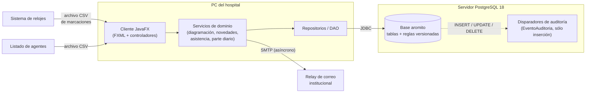

# 🌳 Aromito

**Sistema de diagramación de servicios y gestión trazable del ausentismo · Hospital Municipal de Urgencias (HMU), Córdoba**

[](https://openjdk.org/projects/jdk/25/)
[](https://openjfx.io/)
[](https://www.postgresql.org/)
[](https://maven.apache.org/)
[](https://www.rfc-editor.org/rfc/rfc9106)
[](https://www.ues21.edu.ar/)

Prototipo del Trabajo Final de Graduación (entrega E4). El nombre homenajea al
aromito (*Acacia caven*), árbol nativo de Córdoba.

---

## 📌 El problema

El HMU funciona las 24 horas con una decena de regímenes horarios distintos
(guardias médicas y de enfermería, nocturnos, feriantes, DXI, jefaturas con
guardia pasiva…). Hoy cada jefatura arma el diagrama mensual de su servicio en
planillas, las novedades (cambios de guardia, francos, pases de salida,
justificaciones) circulan en papel y la Oficina de Personal reconstruye a mano,
con las marcaciones del reloj, el **parte diario** que se informa a la
Subsecretaría de Capital Humano. El resultado: errores que se detectan tarde,
reglas que cada uno interpreta a su manera y ninguna trazabilidad de quién
autorizó qué.

## 💡 La propuesta

Aromito integra el circuito completo en una aplicación de escritorio:

1. La **jefatura de servicio (JS)** genera el diagrama desde la modalidad de cada
   agente, lo ajusta y lo valida al instante contra reglas parametrizadas.
2. La **Oficina de Personal (OP)** lo aprueba u observa.
3. Las **novedades** recorren un circuito de autorización JS → OP → Dirección
   (DH), con historial completo, y al aprobarse se aplican sobre el diagrama.
4. Las **marcaciones** se cotejan contra el diagrama vigente y las novedades, y
   el sistema genera el **parte diario**: la OP sólo lo revisa y lo cierra.

---

## ✨ Funcionalidades

### 🔐 Padrón, roles y seguridad
- Inicio de sesión con CUIL y contraseña con hash **Argon2id**; cambio obligatorio de la contraseña inicial.
- Bloqueo al 5.º intento fallido y cierre de sesión tras 30 minutos de inactividad.
- Roles (agente, JS, OP, DH) con vigencia y memorando que los dispone; un usuario puede tener varios.
- Cada perfil ve sólo lo suyo: el agente, sus datos; la JS, su servicio; OP y DH, todo el hospital.
- Padrón único de agentes con altas, bajas lógicas e importación desde CSV con vista previa de filas rechazadas.
- Servicios con agrupación, encargado y dotación mínima por franja horaria; calendario de feriados.

### 🗓️ Diagramación con motor de reglas versionadas
- Grilla agente × día generada desde la modalidad horaria de cada agente (una estrategia por modalidad, con decorador de franquicia), editable por jornada y con cruce de medianoche.
- Validación inmediata con colores: superposición, descanso mínimo de 10 h, topes, guardias de feriante, dotación mínima.
- Reglas en la tabla `ReglaValidacion`, **versionadas por fecha de vigencia** y con su fundamento normativo: se cambian sin tocar el código.
- Errores bloqueantes separados de advertencias; estados borrador → pendiente → aprobado / observado.
- Concurrencia optimista por versión; el diagrama aprobado sólo cambia mediante novedades aprobadas.
- Recordatorio a las JS que no presentaron el diagrama del mes siguiente.

### 📨 Novedades con circuito JS → OP → DH y trazabilidad
- Cambios de guardia y de horario, francos compensatorios, pases de salida, justificaciones, horas extras y omisiones de marcación.
- Validación al cargar (compatibilidad del CG, descanso, saldo de horas, superposición con licencias, tope de faltas justificadas).
- Autorización por instancias: JS (o DH si quien solicita es JS) → verificación de la OP → aprobación de la DH; en cada una se autoriza, observa o rechaza.
- Historial completo de cada decisión (quién, cuándo, resultado y fundamento).
- Avisos en la aplicación y por correo institucional en cada cambio de estado.
- Licencias de origen externo (VeDi / MiDocta) registradas sin tramitarlas.

### ⏱️ Banco de horas FIFO, francos compensatorios y pases de salida
- Las horas extras aprobadas acreditan horas con fecha de vencimiento.
- Francos compensatorios y devoluciones consumen las horas **por orden de vencimiento (FIFO)**.
- Pases de salida oficiales, con retorno y sin retorno (PSSR), con topes parametrizados y devolución de horas.
- Pantalla de banco de horas con créditos, débitos, vencimientos y saldo vigente.

### 📊 Control de asistencia, parte diario e indicadores
- Importación de marcaciones del reloj por archivo (CSV por CUIL, con hash SHA-256 para no duplicar lotes) y conformación de jornadas registradas.
- Cotejo diagrama × marcaciones × novedades: inasistencias, llegadas tarde, retiros anticipados, omisiones y guardias no cubiertas.
- Parte diario con los **códigos numéricos de Capital Humano**, separado por vinculación (relación de dependencia / monotributistas y becarios), con cargas manuales fundamentadas y cierre con versión.
- Indicadores de ausentismo por tipo de novedad y de cobertura por franja, por servicio y período (sólo OP y DH).

### 🛡️ Auditoría por disparadores
- Cada alta, modificación o baja queda en `EventoAuditoria` con los datos anteriores y posteriores, mediante disparadores PL/pgSQL.
- La tabla de auditoría es de sólo inserción: un disparador impide modificarla o borrarla.
- La aplicación informa el usuario de cada transacción (`set_config('app.usuario_id', …)`), así el registro dice quién hizo cada cambio.

---

## 🏗️ Arquitectura



Capas: **UI (JavaFX) → controladores → servicios → repositorios → PostgreSQL**.
Las reglas de negocio parametrizables viven en la base; el envío de correo es
asíncrono y, si no hay relay configurado, los avisos quedan en la aplicación.

---

## 🧰 Stack tecnológico

| Componente | Tecnología |
| --- | --- |
| Lenguaje | Java 25 (LTS) |
| Interfaz | JavaFX 25 + FXML (Scene Builder) |
| Base de datos | PostgreSQL 18 (UUID nativo, ENUM, PL/pgSQL) |
| Acceso a datos | JDBC (driver `org.postgresql` 42.7) |
| Build | Apache Maven |
| Contraseñas | Argon2id (`argon2-jvm`, perfil OWASP m=19456 KiB, t=2, p=1) |
| Configuración | YAML (SnakeYAML) |
| Correo | Jakarta Mail + Angus Mail |
| Contenido enriquecido | Markdown → HTML con flexmark, en `WebView` |
| Pruebas | JUnit 5, Mockito, AssertJ |

---

## 📁 Estructura

```text
hmu-diagramacion/
├── pom.xml
├── README.md
├── capturas/                 # capturas de pantalla del prototipo
├── demo/                     # material de la demostración
├── docs/                     # documentación del TFG
│   ├── der/                  # diagrama entidad-relación
│   └── uml/                  # diagramas UML
├── sql/                      # DDL, vistas y datos de prueba
└── src/
    ├── main/
    │   ├── java/ar/com/hmu/
    │   │   ├── auth/         # inicio de sesión
    │   │   ├── config/       # lectura de config.yaml
    │   │   ├── controller/   # controladores de pantalla
    │   │   ├── model/        # entidades del dominio
    │   │   ├── repository/   # repositorios y DAO (JDBC)
    │   │   ├── roles/        # perfiles y permisos
    │   │   ├── service/
    │   │   │   ├── asistencia/    # marcaciones, cotejo, parte diario, indicadores
    │   │   │   ├── diagramacion/  # generadores por modalidad, validador, reglas
    │   │   │   ├── notification/  # avisos y correo
    │   │   │   └── novedades/     # circuito, validación, banco de horas
    │   │   ├── ui/           # pantallas JavaFX
    │   │   └── util/
    │   └── resources/
    │       ├── config/       # config.yaml, config.local.yaml, config.example.yaml
    │       ├── css/  fonts/  fxml/  images/
    └── test/                 # pruebas JUnit 5
```

---

## 🚀 Instalación

### Requisitos

- JDK 25
- Apache Maven 3.9 o posterior
- PostgreSQL 18

### 1. Crear la base

```sql
CREATE USER aromito WITH PASSWORD 'aromito';
CREATE DATABASE aromito OWNER aromito ENCODING 'UTF8' TEMPLATE template0;
```

### 2. Correr los scripts de `sql/` en este orden

| # | Script | Qué hace |
| --- | --- | --- |
| 1 | `aromito_creacion_de_tablas.sql` | Esquema completo: tablas, tipos ENUM, disparadores de auditoría, vistas de indicadores y catálogos (códigos de novedad, tipos de novedad, reglas de validación). |
| 2 | `aromito_operaciones_CRUD.sql` | Padrón de prueba: domicilios, cargos, servicios, agentes y roles. |
| 3 | `seed_capturas.sql` | Escenario de octubre de 2026 (servicio Guardia Central, diagramas, novedades en todos los estados, saldos de horas). Incluye a `seed_capturas_base.sql` y `seed_capturas_revertir.sql`, que deben estar en la misma carpeta. |

```bash
psql -h localhost -U aromito -d aromito -v ON_ERROR_STOP=1 -f sql/aromito_creacion_de_tablas.sql
psql -h localhost -U aromito -d aromito -v ON_ERROR_STOP=1 -f sql/aromito_operaciones_CRUD.sql
psql -h localhost -U aromito -d aromito -v ON_ERROR_STOP=1 -f sql/seed_capturas.sql
```

> `seed_capturas.sql` es idempotente: revierte el escenario anterior y lo vuelve a cargar.

### 3. Configurar

La aplicación lee **`src/main/resources/config/config.yaml`**. Hay tres archivos en esa carpeta:

| Archivo | Para qué |
| --- | --- |
| `config.yaml` | Configuración en uso. Viene con la del entorno de demostración (credenciales de prueba y relay SMTP sin clave). |
| `config.local.yaml` | Plantilla para un PostgreSQL local (`localhost:5432`, base `aromito`, usuario `aromito`, contraseña `aromito`) y sin correo. |
| `config.example.yaml` | Plantilla en blanco para completar a mano. |

**Para elegir una u otra**, copiá la que quieras sobre `config.yaml`:

```bash
cp src/main/resources/config/config.local.yaml src/main/resources/config/config.yaml
# o, para empezar de cero:
cp src/main/resources/config/config.example.yaml src/main/resources/config/config.yaml
```

…o, sin copiar nada, indicá el archivo al arrancar con `-Daromito.config=<ruta>`
(ver «Ejecución», más abajo).

<details>
<summary><b>⚙️ Referencia de config.yaml</b></summary>

```yaml
db:
  dbType: postgresql
  dbHost: localhost        # servidor PostgreSQL
  dbPort: 5432
  dbName: aromito
  dbUser: aromito
  dbPass: aromito

smtp:
  host: ""                 # vacío = no se envía correo
  port: 587                # 587 con STARTTLS
  from: "Aromito <noreply@hmu.com.ar>"
  auth: true
  tls: true
  username: ""
  password: ""             # con auth: true y sin clave, tampoco se envía correo
```

- Si `smtp.host` está vacío, o si `auth` es `true` y `password` está vacío, **no se envía correo**: los avisos se ven igual en la aplicación (botón «Avisos») y quedan pendientes de envío. Al arrancar sin clave se informa una línea en la consola.
- El remitente (`from`) debe pertenecer a un dominio autenticado en el relay.

</details>

---

## ▶️ Ejecución

```bash
mvn javafx:run
```

Opciones (propiedades del sistema, por `JAVA_TOOL_OPTIONS` con Maven):

| Propiedad | Efecto |
| --- | --- |
| `-Daromito.hoy=2026-10-07` | Fija la fecha de referencia del sistema (la del escenario de prueba). |
| `-Daromito.menu=completo` | Muestra todos los módulos, también los que quedan fuera del alcance del E4 (memorándums y módulos heredados). |
| `-Daromito.capturas=1` | Modo capturas: recorre las pantallas sin iniciar sesión y guarda PNG de 1600×900 en `~/demo/capturas/` (otra carpeta con `-Daromito.capturas.salida=<ruta>`). Requiere el escenario de `seed_capturas.sql`. |
| `-Daromito.config=<ruta>` | Usa ese archivo de configuración en lugar del `config.yaml` empaquetado. |
| `-Daromito.inactividad.minutos=<n>` | Cambia los 30 minutos de cierre por inactividad. |

```bash
# Escenario de prueba, con todos los módulos
JAVA_TOOL_OPTIONS="-Daromito.hoy=2026-10-07 -Daromito.menu=completo" mvn javafx:run

# Modo capturas
JAVA_TOOL_OPTIONS="-Daromito.capturas=1" mvn javafx:run
```

### Jar ejecutable

`mvn package` genera, además del jar común, **`target/aromito-1.0-SNAPSHOT-ejecutable.jar`** con todas las dependencias:

```bash
mvn -DskipTests package
java --enable-native-access=ALL-UNNAMED -Daromito.hoy=2026-10-07 \
     -Daromito.config=src/main/resources/config/config.local.yaml \
     -jar target/aromito-1.0-SNAPSHOT-ejecutable.jar
```

Las bibliotecas nativas de JavaFX son las del sistema operativo donde se compila.
Para generar el jar para Windows desde GNU/Linux: `mvn -Djavafx.platform=win -DskipTests package`.

---

## 🧪 Pruebas

```bash
mvn test
```

**201 pruebas** (JUnit 5 + Mockito + AssertJ) en 18 clases, centradas en el
motor de validación de diagramas, los generadores por modalidad, la validación
y el circuito de novedades, el cotejo de asistencia y el cálculo de horas extras.
No requieren base de datos.

<details>
<summary><b>🔢 Códigos de novedad</b></summary>

El parte diario usa los códigos numéricos de la tabla de Capital Humano (se
cargan completos con el esquema) más tres propios del HMU. Los más usados:

| Código | Sigla | Novedad |
| ---: | --- | --- |
| 1 | FI | Falta injustificada |
| 2 | FJ | Falta justificada |
| 3 / 4 / 5 | T | Llegada tarde (injustificada / con devolución / justificada) |
| 6 | FC | Franco compensatorio |
| 8 | CS | Comisión de servicio |
| 10 – 13 | LIC | Carpeta médica (común, prolongada, accidente de trabajo, familiar) |
| 14, 21 – 25 | LIC | Maternidad, matrimonio, duelo, nacimiento de hijo, examen… |
| 28 | F | Franco |
| 41 | FJ | Falta justificada por fuerza mayor |
| 52 | CAP | Capacitación |
| 56 / 57 | RA | Retiro anticipado (más / menos de una hora) |
| 71 | OM | Omisión de marcación justificada |
| 99 | P | Presente |
| **222** | CH/CG | Cambio de horario o de guardia *(HMU)* |
| **333** | PSSR | Pase de salida sin retorno *(HMU)* |
| **666** | — | Sin justificar: revisar marcación *(HMU)* |

Tipos de novedad que se tramitan en Aromito:

| Tipo | Novedad | Código |
| --- | --- | ---: |
| CG | Cambio de guardia | 222 |
| CH | Cambio de horario | 222 |
| CS | Comisión de servicio | 8 |
| FC | Franco compensatorio | 6 |
| FJ | Falta justificada | 2 |
| HE | Horas extras para FC | — |
| OM | Omisión de marcación | 71 |
| PSO | Pase de salida oficial | — |
| PSP | Pase de salida con retorno | — |
| PSSR | Pase de salida sin retorno | 333 |
| DEV | Devolución de pase de salida | — |
| LIC | Licencia (de origen externo) | según la licencia |

</details>

---

## 🖼️ Capturas

Las capturas de pantalla del prototipo están en la carpeta [`capturas/`](capturas/).

<!-- Agregar aquí las imágenes, por ejemplo:  -->

---

## 📚 Documentación

- [`docs/`](docs/): documento del prototipo (requerimientos, casos de uso, diccionario de datos, pantallas).
- [`docs/uml/`](docs/uml/): diagramas UML.
- [`docs/der/`](docs/der/): diagrama entidad-relación.

---

## 🎬 Demo

> 🔗 *Enlace al video: próximamente.*

Material de apoyo en [`demo/`](demo/).

---

## 💻 Puesta en marcha en otra PC

Paso a paso para una PC con **Windows** sin nada instalado.

### 1. Instalar el JDK 25

1. Descargar **Eclipse Temurin 25 (JDK)** para Windows x64, en formato `.msi`, desde <https://adoptium.net/>.
2. En el instalador, activar **«Set JAVA_HOME variable»** y **«Add to PATH»**.
3. Verificar en una consola nueva (`cmd`):
   ```bat
   java -version
   ```

### 2. Instalar PostgreSQL 18

1. Descargar el instalador de PostgreSQL 18 para Windows desde <https://www.postgresql.org/download/windows/>.
2. Instalar con las opciones por defecto (puerto **5432**). Anotar la contraseña que se elige para el usuario `postgres`.
3. Agregar `C:\Program Files\PostgreSQL\18\bin` al `PATH` (o usar la ruta completa de `psql.exe` en los comandos siguientes).

### 3. (Opcional) Instalar Maven

Sólo hace falta para compilar o para ejecutar con `mvn javafx:run`. Si se usa el
jar ejecutable ya compilado para Windows, se puede saltear.

1. Descargar el **Binary zip archive** de Apache Maven desde <https://maven.apache.org/download.cgi>.
2. Descomprimirlo, por ejemplo, en `C:\maven`, y agregar `C:\maven\bin` al `PATH`.
3. Verificar: `mvn -version`.

### 4. Crear la base y el usuario

```bat
psql -U postgres -c "CREATE USER aromito WITH PASSWORD 'aromito';"
psql -U postgres -c "CREATE DATABASE aromito OWNER aromito ENCODING 'UTF8' TEMPLATE template0;"
```

### 5. Cargar los scripts de `sql/` y el seed

Desde la carpeta del proyecto. La primera línea evita problemas con los acentos en la consola de Windows:

```bat
set PGCLIENTENCODING=UTF8
psql -h localhost -U aromito -d aromito -v ON_ERROR_STOP=1 -f sql\aromito_creacion_de_tablas.sql
psql -h localhost -U aromito -d aromito -v ON_ERROR_STOP=1 -f sql\aromito_operaciones_CRUD.sql
psql -h localhost -U aromito -d aromito -v ON_ERROR_STOP=1 -f sql\seed_capturas.sql
```

(La contraseña que pide `psql` es `aromito`.)

Después, para que todos los usuarios de prueba entren con la misma contraseña
(`Aromito1`), abrir `psql -h localhost -U aromito -d aromito` y ejecutar:

```sql
UPDATE Usuario
SET passwordHash = '$2a$12$dUczG8OtzxElYH.qAXbtUOHVKORj4zJH2eoy5WXfXqXUm0vRq3obO'
WHERE cuil IN (27111122277, 24111144499, 27991000018, 27991000050);
```

> Sin este paso, Medina y Valdez entran con su propio CUIL como contraseña (y el
> sistema les pide cambiarla), y Paz y Moreno con `27111122277`.

### 6. Configurar

```bat
copy src\main\resources\config\config.local.yaml src\main\resources\config\config.yaml
```

### 7. Ejecutar

**Con Maven** (con la fecha del escenario de prueba):

```bat
set JAVA_TOOL_OPTIONS=-Daromito.hoy=2026-10-07
mvn javafx:run
```

**Con el jar** (generado en esa PC con `mvn -DskipTests package`, o en otra con
`mvn -Djavafx.platform=win -DskipTests package` y copiado junto con `config.local.yaml`):

```bat
java --enable-native-access=ALL-UNNAMED -Daromito.hoy=2026-10-07 -Daromito.config=config.local.yaml -jar aromito-1.0-SNAPSHOT-ejecutable.jar
```

### 8. Usuarios de prueba

Contraseña de todos: **`Aromito1`** (después del paso 5).

| Rol | Agente | CUIL | Servicio |
| --- | --- | --- | --- |
| Agente | Moreno, Daniela | `27991000050` | Guardia Central |
| Jefatura de servicio (JS) | Paz, Mariela | `27991000018` | Guardia Central |
| Oficina de Personal (OP) | Medina, Rosa | `27111122277` | Personal |
| Dirección (DH) | García, Pedro | `20111111122` | Dirección |

Todos los datos son ficticios: nombres inventados y CUIL que no corresponden a personas reales.

---

## 👤 Autoría

**Pablo Alejandro Hamann** · Director: **Ing. Jorge Cassi**
Licenciatura en Informática · Universidad Siglo 21 · 2026

## 📄 Licencia

Todos los derechos reservados (trabajo académico).
