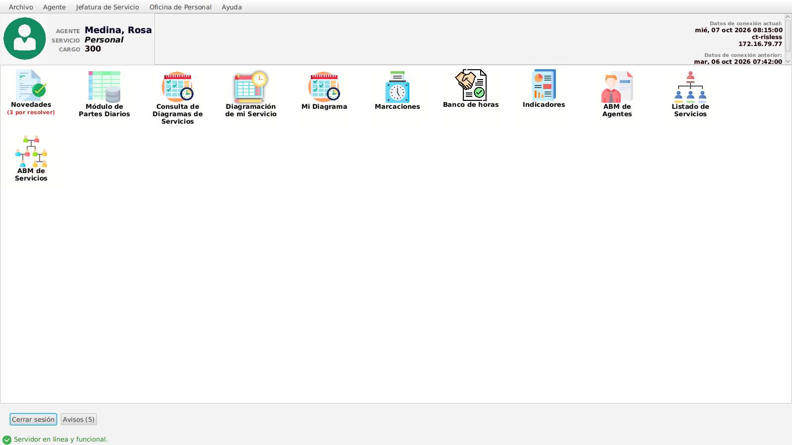
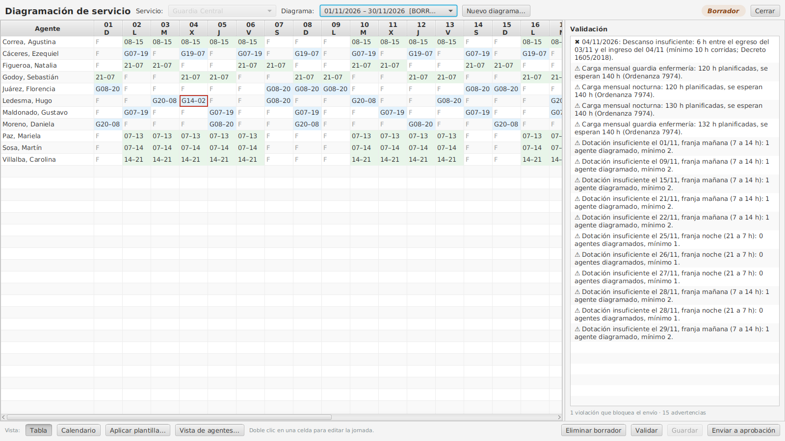
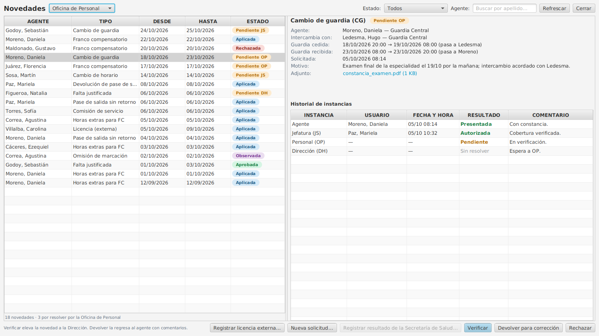
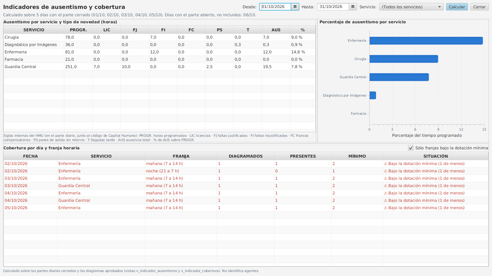
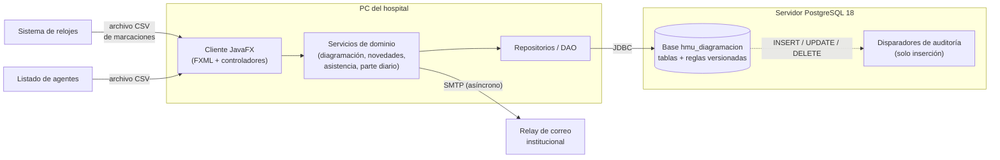

# HMU Diagramación

**Diagramación de servicios y gestión trazable del ausentismo**
Hospital de Urgencias de Córdoba (HMU) · Trabajo Final de Grado

[](https://openjdk.org/projects/jdk/25/)
[](https://openjfx.io/)
[](https://www.postgresql.org/)
[](https://maven.apache.org/)
[](https://www.rfc-editor.org/rfc/rfc9106)
[](https://www.ues21.edu.ar/)

## ¿Qué es?

El HMU funciona las 24 horas con una decena de regímenes horarios. Cada
jefatura arma el diagrama mensual de su servicio en planillas propias, la
Oficina de Personal controla a mano contra las marcaciones del reloj, y los
errores suelen aparecer recién en la liquidación de haberes. Este prototipo
integra ese circuito: valida el diagrama en el momento de la carga contra
reglas parametrizadas, tramita las novedades con un circuito autorizante
trazable (Jefatura de Servicio → Oficina de Personal → Dirección), genera el
parte diario y los indicadores en forma automática, y restringe cada
operación según el rol de quien la realiza.

> 🎬 **[Video de demostración](https://nube.hmu.com.ar/index.php/s/WPWzKf3tEH9ABRZ)** ·
> ⬇️ **[Última versión compilada](https://github.com/linkstat/hmu-diagramacion/releases/latest)**

## 🚀 Probar en 5 minutos (Windows)

1. Instalar [Eclipse Temurin 25 (JDK)](https://adoptium.net/) y
   [PostgreSQL 18](https://www.postgresql.org/download/windows/) (puerto 5432;
   anotar la contraseña elegida para el usuario `postgres`).
2. Descargar `hmu-diagramacion-1.0.0-windows.zip` desde la
   [última release](https://github.com/linkstat/hmu-diagramacion/releases/latest)
   y descomprimirlo.
3. Ejecutar **`instalar-bd.cmd`**: crea el usuario y la base `hmu_diagramacion`
   y carga el esquema, los datos de prueba y el escenario de demostración.
4. Ejecutar **`iniciar-demo.cmd`**: abre la aplicación con la fecha fija del
   escenario (miércoles 07/10/2026).

Usuarios de prueba (datos ficticios; los CUIL no corresponden a personas reales):

| Rol | Agente | CUIL | Servicio | Contraseña |
| --- | --- | --- | --- | --- |
| Agente | Moreno, Daniela | `27991000050` | Guardia Central | `HMU.2026` |
| Jefatura de Servicio (JS) | Paz, Mariela | `27991000018` | Guardia Central | `HMU.2026` |
| Oficina de Personal (OP) | Medina, Rosa | `27111122277` | Personal | `HMU.2026` |
| Dirección (DH) | García, Pedro | `20111111122` | Dirección | `HMU.2026` |
| Agente (primer ingreso) | Valdez, Mateo | `24111144499` | Biomédica | `24111144499` → el sistema exige cambiarla |

La instalación detallada (también desde el código fuente y en GNU/Linux) está
en **[docs/INSTALACION.md](docs/INSTALACION.md)**.

## ✨ Funcionalidades

**🔐 Padrón, roles y seguridad** — Ingreso con CUIL y contraseña (hash
Argon2id); bloqueo al 5.º intento fallido, cierre de sesión por inactividad y
cambio obligatorio de la contraseña inicial. Roles con vigencia (agente, JS,
OP, DH); cada perfil ve solo lo que le corresponde. Padrón único con
importación desde CSV, servicios con dotación mínima y calendario de feriados.

**🗓️ Diagramación con reglas versionadas** — Grilla agente × día generada
desde la modalidad horaria de cada agente y editable por jornada, con cruce de
medianoche. Validación inmediata (superposición, descanso mínimo de 10 h,
topes, guardias, dotación mínima) contra reglas almacenadas en la base,
versionadas por fecha de vigencia y modificables sin tocar el código. Estados
borrador → pendiente → aprobado/observado, con concurrencia optimista por
versión; el diagrama aprobado solo cambia mediante novedades aprobadas.

**📨 Novedades con trazabilidad y banco de horas** — Cambios de guardia y de
horario, francos compensatorios, pases de salida, justificaciones, horas
extras y omisiones de marcación, validados al cargarse. Circuito JS → OP → DH
con historial completo de cada decisión (quién, cuándo, resultado y
fundamento) y avisos en la aplicación y por correo. Las horas extras
aprobadas acreditan un banco de horas con vencimiento que los francos y
devoluciones consumen por orden de vencimiento (FIFO). Las licencias de
origen externo se registran sin tramitarse.

**📊 Asistencia, parte diario e indicadores** — Importación de marcaciones
del reloj por archivo y cotejo automático contra el diagrama vigente y las
novedades aprobadas: inasistencias, llegadas tarde, retiros anticipados,
omisiones y guardias no cubiertas. Parte diario con los códigos de la
Subsecretaría de Capital Humano, separado por vinculación, con cargas
manuales fundamentadas y cierre con versión. Indicadores de ausentismo y
cobertura por servicio y período (solo OP y DH).

**🛡️ Auditoría por disparadores** — Cada alta, modificación o baja queda
registrada por disparadores PL/pgSQL con los datos anteriores y posteriores y
el usuario que la realizó; la tabla de auditoría solo admite inserciones.

## 🖼️ Capturas

| | |
| :---: | :---: |
| [](capturas/Fig22_menu_principal.png) *Menú principal* | [](capturas/Fig30_diagramacion_mensual.png) *Diagramación con panel de validación* |
| [](capturas/Fig39_novedades_op.png) *Novedades: bandeja de la OP* | [](capturas/Fig46_indicadores.png) *Indicadores de ausentismo y cobertura* |

Las 27 pantallas del prototipo están en [`capturas/`](capturas/).

## 🏗️ Arquitectura



| Componente | Tecnología |
| --- | --- |
| Lenguaje | Java 25 (LTS) |
| Interfaz | JavaFX 25 + FXML (Scene Builder) |
| Base de datos | PostgreSQL 18 (UUID nativo, ENUM, PL/pgSQL) |
| Acceso a datos | JDBC (driver `org.postgresql`) |
| Build | Apache Maven |
| Contraseñas | Argon2id (`argon2-jvm`; m=19456 KiB, t=2, p=1) |
| Configuración | YAML (SnakeYAML) |
| Correo | Jakarta Mail + Angus Mail |
| Contenido enriquecido | Markdown → HTML (flexmark) en `WebView` |
| Pruebas | JUnit 5, Mockito, AssertJ |

## 🛠️ Compilar desde el código

```bash
mvn javafx:run          # ejecuta desde el código fuente
mvn package             # genera target/hmu-diagramacion.jar (ejecutable, con dependencias)
```

El jar incluye las bibliotecas nativas de JavaFX del sistema operativo donde
se compila; `mvn -Djavafx.platform=win package` genera desde GNU/Linux el jar
para Windows. Propiedades del sistema (con Maven se pasan por
`JAVA_TOOL_OPTIONS`):

| Propiedad | Efecto |
| --- | --- |
| `-Dhmu.hoy=2026-10-07` | Fija la fecha de referencia (la del escenario de demostración). |
| `-Dhmu.menu=completo` | Muestra también los módulos fuera del alcance del prototipo. |
| `-Dhmu.capturas=1` | Modo capturas: recorre las pantallas y guarda PNG de 1600×900 (`-Dhmu.capturas.salida=<ruta>` cambia el destino; `-Dhmu.capturas.solo=<lista>` filtra). |
| `-Dhmu.config=<ruta>` | Usa ese archivo de configuración en lugar del `config.yaml` empaquetado. |
| `-Dhmu.inactividad.minutos=<n>` | Cambia los 30 minutos del cierre por inactividad. |

<details>
<summary><b>⚙️ Referencia de config.yaml</b></summary>

La aplicación lee `src/main/resources/config/config.yaml` (o el archivo
indicado con `-Dhmu.config`). El empaquetado ya viene listo para una base
local de evaluación; `config.example.yaml` es la plantilla en blanco.

```yaml
db:
  dbType: postgresql
  dbHost: localhost        # servidor PostgreSQL
  dbPort: 5432
  dbName: hmu_diagramacion
  dbUser: hmu_diagramacion
  dbPass: hmu_diagramacion

smtp:
  host: ""                 # vacío = no se envía correo
  port: 587                # 587 con STARTTLS
  from: "HMU Diagramación <rrhh-no-responder@hmu.com.ar>"
  auth: true
  tls: true
  username: ""
  password: ""             # con auth: true y sin clave, tampoco se envía correo
```

Con `smtp.host` vacío —o con `auth: true` y `password` vacío— no se envía
correo: los avisos se ven igual en la aplicación (botón «Avisos») y quedan
pendientes de envío.

</details>

## 🧪 Pruebas

```bash
mvn test
```

**204 pruebas** (JUnit 5 + Mockito + AssertJ) en 19 clases: motor de
validación de diagramas, generadores por modalidad horaria, validación y
circuito de novedades, cotejo de asistencia, cálculo de horas extras y
verificación de las credenciales de prueba contra los seeds. No requieren
base de datos.

## 📚 Documentación

El documento completo del TFG está en
[`docs/TFG-Hamann-Pablo-Alejandro.pdf`](docs/TFG-Hamann-Pablo-Alejandro.pdf).
Las figuras, por carpeta:

| Carpeta | Contenido | Figura del TFG |
| --- | --- | --- |
| [`docs/gantt/`](docs/gantt/) | Planificación del proyecto (Gantt) | Figura 1 |
| [`docs/organigrama/`](docs/organigrama/) | Organigrama del HMU | Figura 2 |
| [`docs/bpmn/`](docs/bpmn/) | Proceso de negocio (BPMN) | Figura 3 |
| [`docs/uml/`](docs/uml/) | Casos de uso | Figuras 4–9 |
| [`docs/uml/`](docs/uml/) | Diagramas de secuencia | Figuras 10–12 |
| [`docs/uml/`](docs/uml/) | Diagramas de clases | Figuras 13–19 |
| [`docs/der/`](docs/der/) | Diagrama entidad-relación (con sus scripts de generación) | Figura 20 |
| [`capturas/`](capturas/) | Pantallas del prototipo | Figuras 21–47 |
| [`docs/uml/`](docs/uml/) | Diagrama de despliegue | Figura 48 |
| [`docs/anexos/`](docs/anexos/) | Formularios actuales del HMU (anonimizados) | Anexos 1–5 |
| [`docs/normativa/`](docs/normativa/) | Ordenanzas y decretos municipales citados | — |

## 📁 Estructura

```text
hmu-diagramacion/
├── pom.xml
├── capturas/             # pantallas del prototipo (Figuras 21–47)
├── demo/                 # material de la demostración
├── distribucion/         # scripts de instalación y arranque (van en el zip de cada release)
├── docs/                 # TFG, figuras, anexos y normativa
├── sql/                  # 01_esquema, 02_datos_prueba, 03_escenario_demo
└── src/
    ├── main/java/ar/com/hmu/      # auth, config, controller, model, repository,
    │                              # roles, service (asistencia, diagramacion,
    │                              # notification, novedades), ui, util
    ├── main/resources/            # config, css, fonts, fxml, images
    └── test/java/                 # pruebas JUnit 5
```

<details>
<summary><b>🔢 Códigos de novedad</b></summary>

El parte diario usa los códigos numéricos de la Subsecretaría de Capital
Humano (se cargan completos con el esquema) más tres propios del HMU. Los más
usados:

| Código | Sigla | Novedad |
| ---: | --- | --- |
| 1 | FI | Falta injustificada |
| 2 | FJ | Falta justificada |
| 3 / 4 / 5 | T | Llegada tarde (injustificada / con devolución / justificada) |
| 6 | FC | Franco compensatorio |
| 8 | CS | Comisión de servicio |
| 10 – 13 | LIC | Carpeta médica (común, prolongada, accidente de trabajo, familiar) |
| 14, 21 – 25 | LIC | Maternidad, matrimonio, duelo, nacimiento de hijo, examen… |
| 28 | F | Franco |
| 41 | FJ | Falta justificada por fuerza mayor |
| 52 | CAP | Capacitación |
| 56 / 57 | RA | Retiro anticipado (más / menos de una hora) |
| 71 | OM | Omisión de marcación justificada |
| 99 | P | Presente |
| **222** | CH/CG | Cambio de horario o de guardia *(propio del HMU)* |
| **333** | PSSR | Pase de salida sin retorno *(propio del HMU)* |
| **666** | — | Sin justificar: revisar marcación *(propio del HMU)* |

Tipos de novedad que se tramitan en la aplicación:

| Tipo | Novedad | Código |
| --- | --- | ---: |
| CG | Cambio de guardia | 222 |
| CH | Cambio de horario | 222 |
| CS | Comisión de servicio | 8 |
| FC | Franco compensatorio | 6 |
| FJ | Falta justificada | 2 |
| HE | Horas extras para franco compensatorio | — |
| OM | Omisión de marcación | 71 |
| PSO | Pase de salida oficial | — |
| PSP | Pase de salida con retorno | — |
| PSSR | Pase de salida sin retorno | 333 |
| DEV | Devolución de pase de salida | — |
| LIC | Licencia (de origen externo) | según la licencia |

</details>

## 👤 Autoría

**Pablo Alejandro Hamann** · Director: **Ing. Jorge Cassi**
Licenciatura en Informática · Universidad Siglo 21 · 2026

## 📄 Licencia

Todos los derechos reservados (trabajo académico).
